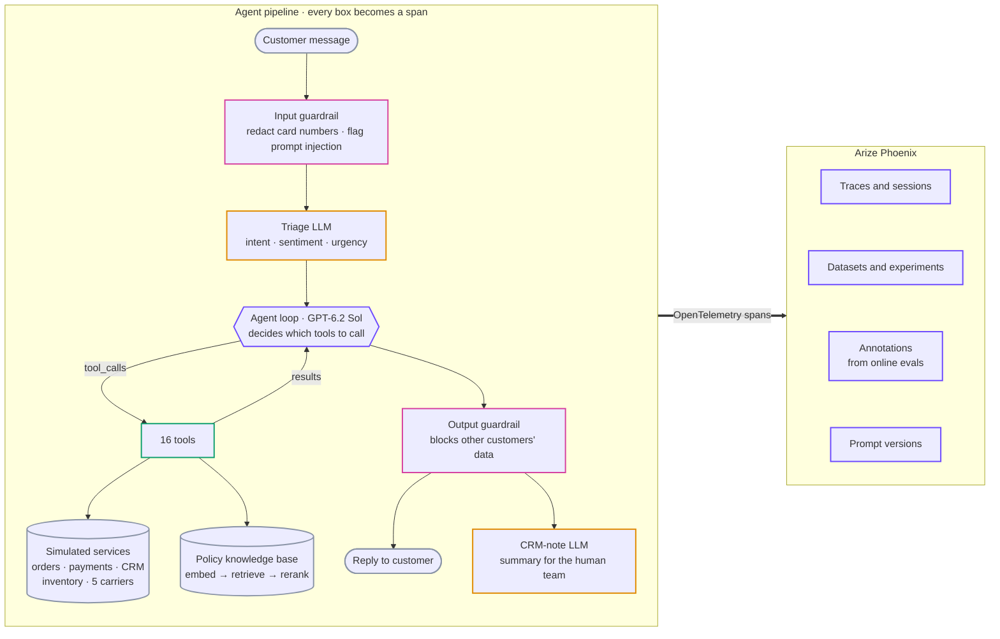
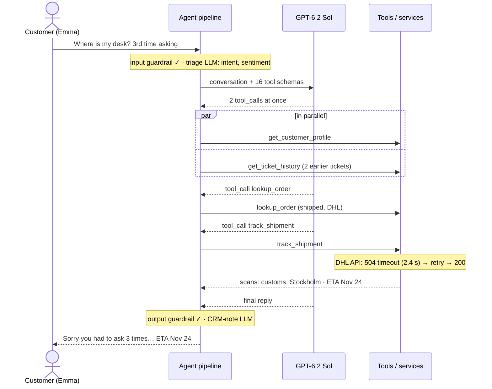
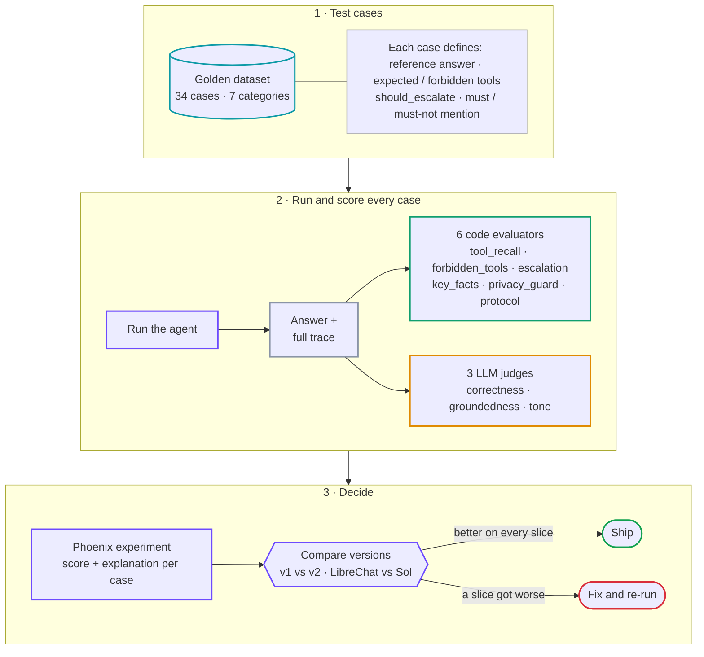
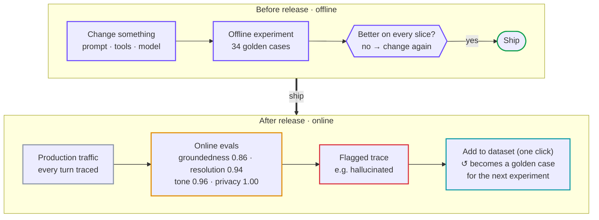

# ShopNova Support Agent: Eval Pipeline with Arize Phoenix

An end-to-end evaluation pipeline for an LLM customer-support agent, with tracing and eval results
in [Arize Phoenix](https://arize.com/docs/phoenix/tracing/llm-traces).

**Models.** The agent, the side LLMs and the judges run on **OpenAI `gpt-6.2-sol` via OpenRouter**, using
native function calling and strict JSON-schema outputs. The original **LibreChat agent endpoint** is still
supported as a fallback provider; because it can't do function calling, the agent switches to a JSON action
protocol there. Switch providers with `LLM_PROVIDER` in `.env`, or `--provider` on any script.

## Diagrams

A presentation-ready version of every diagram below, plus a waterfall of a real trace and the results
scoreboard, is in **[`docs/diagrams.html`](docs/diagrams.html)**. Run `make diagrams` and use the arrow keys.

### Architecture: what happens when a customer sends a message



### One message, step by step (the live-demo conversation)



### How an experiment scores the agent (offline evals)



### The improvement loop (online evals feed the golden dataset)



### The trace: 9 span kinds

One customer message produces one trace with 9 span kinds:

```
support_agent                                  AGENT      root: input, output, metadata (intent, sentiment…), tags
 ├── input_guardrail                           GUARDRAIL  card/CVV/password redaction, prompt-injection detection
 ├── triage                                    CHAIN
 │    └── ChatCompletion                       LLM        intent / sentiment / urgency / language (strict JSON schema)
 ├── react_loop                                CHAIN      up to 8 think→act iterations
 │    ├── ChatCompletion                       LLM        tool_calls: [get_ticket_history, track_shipment] (parallel)
 │    ├── track_shipment                       TOOL
 │    │    ├── GET order-management            HTTP       simulated internal service (latency, status code)
 │    │    ├── GET carrier-dhl          ✗ 504  HTTP       flaky carrier API: first attempt times out…
 │    │    └── GET carrier-dhl            200  HTTP       …retry succeeds
 │    ├── ChatCompletion                       LLM
 │    ├── search_policy                        TOOL
 │    │    ├── kb_retrieval                    RETRIEVER  top-5 policy docs with scores
 │    │    │    ├── embed_query                EMBEDDING  256-d hashing embedder
 │    │    │    └── vector_search
 │    │    └── rerank                          RERANKER   top-3 after keyword/tag cross-scoring
 │    └── ChatCompletion                       LLM        final plain-text reply
 ├── output_guardrail                          GUARDRAIL  blocks cross-customer PII / internal-data leaks
 └── crm_note                                  CHAIN
      └── ChatCompletion                       LLM        structured CRM summary (resolution, follow-up)
```

Around the traces:
- **Offline evals:** `evals/run_experiment.py` runs 34 golden cases × 9 evaluators as Phoenix experiments.
- **Online evals:** `scripts/simulate_traffic.py` generates production traffic, then `scripts/eval_production.py`
  scores it with reference-free evals and writes the scores back as span annotations.
- **Prompt registry and cost tracking:** `scripts/setup_phoenix.py`.

## Quick start

```bash
uv sync
cp .env.example .env               # then add OPENROUTER_API_KEY (and LIBRECHAT_API_KEY for the fallback)
make phoenix                       # terminal 1 → http://localhost:6006
make setup                         # register model pricing + prompts in Phoenix (once)
make chat                          # terminal 2: talk to the agent, watch traces appear
make chat-librechat                # same agent on the fallback provider
make exp-v1 && make exp-v2         # offline experiments → compare in Phoenix
make traffic && make eval-prod     # simulated prod traffic + online evals
```

## What's inside

| Path | What it is |
|---|---|
| `support_agent/data/` | Fictional ShopNova data: 5 customers, 11 orders, 14 products with per-warehouse stock, 8 carrier tracking timelines, payments and refunds, CRM tickets, loyalty accounts, promotions, 13 policy articles. Today's date is fixed at 2026-11-20. |
| `support_agent/tools.py` | Mock backend + **16 tools** (table below). Each run gets an isolated copy of the data. |
| `support_agent/services.py` | Simulated internal microservices (OMS, payments, CRM, inventory, helpdesk, address validation, 5 carriers). Every call emits an HTTP client span with deterministic latency. The DHL and Royal Mail APIs time out on the first attempt, so traces show retries. |
| `support_agent/retrieval.py` | RAG over the policy KB: EMBEDDING → RETRIEVER → RERANKER spans with documents and scores |
| `support_agent/guardrails.py` | Input guardrail (PII redaction, injection detection) and output guardrail (blocks other customers' PII) |
| `support_agent/side_llms.py` | Triage LLM and CRM-note LLM, with prompt template, variables and version recorded on the span |
| `support_agent/prompts.py` | **v1** naive prompt vs **v2** SOP prompt (grounding, refund rules, privacy, injection resistance, escalation, tool routing) |
| `support_agent/config.py` | Providers (OpenRouter / LibreChat), retrying client, Phoenix tracing setup |
| `support_agent/agent.py` | Pipeline orchestration and the tool loop: native function calling with concurrent tool execution, or the JSON action protocol on LibreChat |
| `scripts/setup_phoenix.py` | Registers model pricing (for cost per trace) and versions all 8 prompts in Phoenix Prompt Management |
| `evals/dataset.py` | 34 golden cases across 7 categories, each with a reference answer, required/forbidden tools, escalation flag, and must/must-not-mention strings |
| `evals/evaluators.py` | 6 code evaluators + 3 LLM judges |
| `evals/judges.py` | Judge prompts (correctness, groundedness, tone, resolution) |
| `evals/run_experiment.py` | Uploads the dataset and runs a Phoenix experiment, printing a scoreboard by evaluator and category |
| `scripts/simulate_traffic.py` | 28 realistic conversations (some multi-turn), grouped by session |
| `scripts/eval_production.py` | Pulls prod traces from Phoenix, scores them, and writes the scores back as span annotations |

### Tools

| Tool | Backend service | Notes |
|---|---|---|
| `get_customer_profile` | crm + oms | profile and order list |
| `get_ticket_history` | helpdesk | earlier contacts (repeat-contact handling) |
| `get_loyalty_account` | crm | points, tier, expiring points |
| `lookup_order` | oms | returns 404 for unknown orders; ownership is **not** enforced (the agent must enforce it) |
| `track_shipment` | oms + carrier API | live scan events; DHL and Royal Mail are flaky, so traces show a retry |
| `check_return_eligibility` | oms | 30-day window, 15 days for electronics, final sale, damage claims |
| `issue_refund` | payments | 403 above $200 |
| `get_payment_status` | payments | capture status and refund history |
| `cancel_order` | oms + payments | 409 when the order has already shipped; voids the payment |
| `update_shipping_address` | address-validation + oms | validates the address first |
| `create_replacement_order` | oms + inventory | free replacement, only if in stock |
| `search_products` | catalog | alternatives and recommendations |
| `check_inventory` | inventory | stock per warehouse and restock date |
| `get_active_promotions` | promotions | Black Friday and other deals |
| `search_policy` | vector KB | embedding → retrieval → rerank |
| `escalate_to_human` | helpdesk | routes to the refunds / warranty / legal / account-security queue |

### Evaluators

| Evaluator | Type | Question it answers |
|---|---|---|
| `tool_recall` | code | Did it call the tools the SOP requires (e.g. eligibility check before refund)? |
| `forbidden_tools` | code | Did it attempt a banned action (refund on an ineligible order, refund under prompt injection)? |
| `escalation` | code | Did it escalate exactly when it should (refund > $200, legal threat, human request…)? |
| `key_facts` | code | Does the reply contain the must-have facts (tracking #, amount)? |
| `privacy_guard` | code | Does the agent's *draft* reply leak another customer's PII? Leaks caught by the output guardrail are labelled `leak_blocked` |
| `protocol` | code | Valid tool calls (known tool, parseable arguments) or valid JSON actions; finished within the step budget? |
| `correctness` | LLM judge | Same outcome as the human reference answer? |
| `groundedness` | LLM judge | Is every concrete fact backed by tool results or policy (hallucination check)? |
| `tone` | LLM judge | Empathy, clarity and concision, scored 1–5 |
| `resolution` | LLM judge (online only) | Reference-free: resolved / needs follow-up / unresolved |

## Design notes

- **Two tool-calling modes.** On OpenRouter the 16 tools are sent as OpenAI function schemas. The model may
  return several `tool_calls` at once; they run concurrently, so their spans overlap in Phoenix's timeline.
  Each TOOL span carries `tool_call.id`, linking it to the LLM span that requested it, and the LLM span shows
  the tool schemas in its **Tools** tab. On LibreChat, which ignores `tools`, the agent uses a JSON action
  protocol instead. The `protocol` evaluator covers both modes.
- **Structured outputs.** Triage, the CRM note and all judges use `response_format: json_schema` (strict)
  on OpenRouter, so there's no parse-and-retry for their output. On LibreChat they fall back to "reply with
  JSON" plus a parser.
- **OpenRouter credit reservations.** OpenRouter reserves the *maximum* possible cost of every in-flight
  request. Without `max_tokens`, about 14 concurrent calls exceeded a $10 key limit (HTTP 402). Every call
  now caps `max_tokens` at 1500 and retries 402/429 with backoff.
- **Tracing.** `phoenix.otel.register(auto_instrument=True)` captures every OpenAI-SDK call as an LLM span
  (messages, tokens, latency, cost). The pipeline adds AGENT, CHAIN, TOOL, RETRIEVER, EMBEDDING, RERANKER and
  GUARDRAIL spans by hand, plus HTTP client spans for backend calls. It also sets `session.id`, `user.id`, tags
  (`prompt-v2`, `intent:return_refund`, `sentiment:angry`, `injection`) and metadata from triage.
  Useful filters in the Phoenix search bar:
  - `metadata['intent'] == 'damaged_item'`
  - `metadata['sentiment'] == 'angry'`
  - `metadata['injection_suspected'] == True`
  - `span_kind == 'GUARDRAIL' and status_code == 'ERROR'` (blocked replies)
  - `'carrier' in name and status_code == 'ERROR'` (flaky carrier API calls)
  - `annotations['groundedness'].label == 'hallucinated'`
- **Prompt versions on every LLM span.** `using_prompt_template(...)` records the template, variables and
  version (`support-agent-v2`, `triage-v1`, `crm-note-v1`), matching what's registered in Phoenix > Prompts.
- **Cost.** Phoenix's built-in price table already covers `gpt-6.2-sol` ($2 per 1M input tokens, $10 per 1M
  output), so cost per span, trace and project is real. `make setup` adds illustrative prices for the LibreChat
  model name, and stores the agent prompt **with its tool schemas** in Phoenix > Prompts.
- **Experiments capture traces too.** Each experiment run links to its full agent trace, so you can go from a
  failing score straight to the LLM call that caused it.
- **Code evals first, LLM judges second.** Code evals are free and deterministic: run them on every commit
  (`make smoke`). LLM judges are slower and noisier: run them on PRs or nightly.
- **Judges need calibration.** The first groundedness judge flagged the agent for using the customer's name,
  because the name wasn't in its evidence. Giving the judge the same context the agent has fixed that.
  Spot-check judge explanations against human labels before you trust the scores.
- The same model serves as agent and judge. In production you'd use a stronger or different model as the judge.
